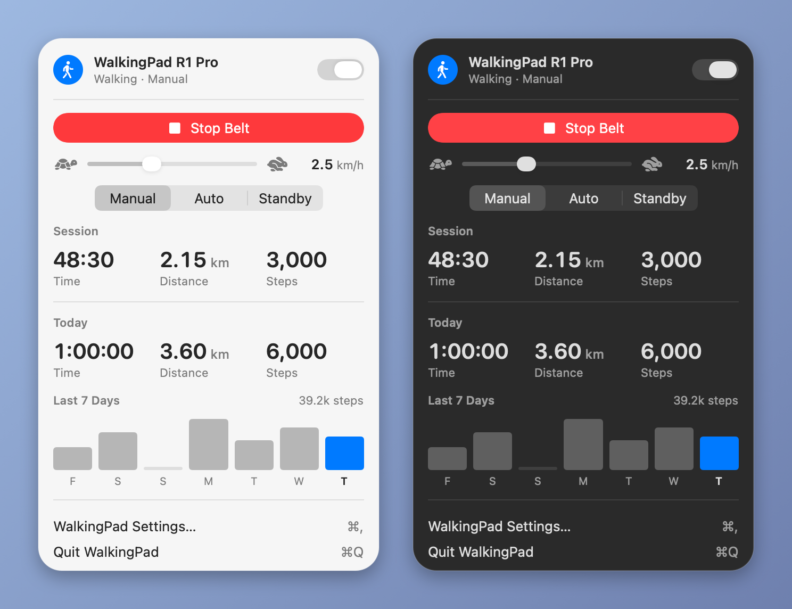

# WalkingPad for macOS

Control a KingSmith **WalkingPad** treadmill over Bluetooth from the macOS menu
bar: start and stop the belt, change speed and mode, and keep an eye on your
steps. No vendor app, no account, no network access.

This is the macOS version of
[omarchy-walkingpad](https://github.com/kristijanzrno/omarchy-walkingpad). It
does the same things, as a native Swift app that looks like the rest of macOS.



<sub>Rendered from the app's own view with sample data. On macOS 26 the popup
sits on Liquid Glass, like Control Center.</sub>

## Features

- **Menu bar item** that shows your speed (or steps) while you walk
- **Popup** with start/stop, a speed slider, Manual / Auto / Standby mode,
  session stats, today's totals and a 7-day step chart
- **Mouse and keyboard control**: scroll on the menu bar item to change speed,
  or drive the whole popup from the keyboard
- **Command line and URL scheme** (`walkingpad toggle`, `walkingpad://faster`,
  …) for keyboard shortcuts in Shortcuts, Raycast, Alfred, skhd and so on
- **Local history**: daily totals stay on your Mac, last 30 days
- **Native**: SwiftUI and CoreBluetooth, light and dark mode, Liquid Glass on
  macOS 26, open at login

## Supported pads

| Status | Models |
|---|---|
| ✅ Tested | **WalkingPad R1 Pro** |
| 🟡 Should work, untested | A1, A1 Pro, R1, C1, C2 |
| ❌ Not supported | Newer models that only speak the standard fitness-machine profile (FTMS), such as the Z1 |

The app finds pads by their Bluetooth protocol (service `FE00`) or name, not by
model, so any WalkingPad that uses that protocol should work. If you try it on
another model, please open an issue saying whether it worked.

## Requirements

- macOS 14 Sonoma or later (Apple silicon or Intel)
- Bluetooth switched on
- To build it yourself: Xcode 26 or later

No pairing is needed. On first run the app scans for the pad, then remembers
it. The first time it starts, macOS asks to let WalkingPad use Bluetooth; say
yes. If you said no, turn it on in **System Settings › Privacy & Security ›
Bluetooth**.

## Install

The quickest route is Homebrew. See [Homebrew](#homebrew) at the end. You can
also download `WalkingPad-<version>.zip` from the
[releases](https://github.com/kristijanzrno/macos-walkingpad/releases), unzip
it and move `WalkingPad.app` to Applications. Because the app isn't notarized,
run `xattr -dr com.apple.quarantine /Applications/WalkingPad.app` once before
opening it.

To build it yourself:

```bash
git clone https://github.com/kristijanzrno/macos-walkingpad.git
cd macos-walkingpad
scripts/build-app.sh --install
```

That builds `build/WalkingPad.app`, copies it to `/Applications` and starts
it. Without `--install` it only builds.

To start it with your Mac, turn on **Open at login** in WalkingPad Settings.

## Remove

Quit WalkingPad from its popup (⌘Q), then delete `/Applications/WalkingPad.app`.
Your saved pad and step history are kept in
`~/Library/Application Support/WalkingPad/`, so a reinstall picks them up.
Delete that folder if you want them gone, and run
`defaults delete io.github.kristijanzrno.walkingpad` to reset the settings.

## Using it

| Where | Input | Action |
|---|---|---|
| Menu bar | click | open popup |
| Menu bar | right-click or control-click | start / stop belt |
| Menu bar | middle click | connect / disconnect |
| Menu bar | scroll | faster / slower (while walking) |
| Popup | `space` / `s` / `return` | start / stop belt |
| Popup | `←` `→` / `-` `+` | slower / faster |
| Popup | `m` | cycle Manual → Auto → Standby |
| Popup | `c` | connect / disconnect |
| Popup | `esc` | close |
| Popup | `⌘,` | settings |
| Popup | `⌘Q` | quit |

When starting, the pad switches itself to Manual mode, counts down 3 seconds,
then the app sets the **Speed after starting** (default 2.0 km/h).

**The phone app:** a WalkingPad accepts one Bluetooth connection at a time. To
use the KS Fit app, flip the switch in the popup header (or middle-click the
menu bar item) to disconnect, or turn off **Connect automatically**.

## Keyboard shortcuts and scripts

The running app takes commands two ways.

**Command line.** The app binary doubles as a CLI. Homebrew puts it on your
`PATH` as `walkingpad`; for a manual install, link it yourself:

```bash
ln -s /Applications/WalkingPad.app/Contents/MacOS/WalkingPad /usr/local/bin/walkingpad
```

```bash
walkingpad toggle       # start / stop
walkingpad start        # start at your "Speed after starting"
walkingpad start 3.0    # start, then go to 3.0 km/h
walkingpad stop
walkingpad faster
walkingpad slower
walkingpad speed 3.5
walkingpad mode auto    # manual | auto | standby
walkingpad connect
walkingpad disconnect
walkingpad forget       # forget the saved pad
walkingpad popup        # open / close the popup (also: open, close)
walkingpad status       # JSON
```

Commands exit with status 1 and print the reason if they can't run, for
example `Not connected`.

**URLs.** The same commands work as `walkingpad://` URLs, with `/` between the
command and its argument:

```bash
open walkingpad://toggle
open walkingpad://speed/3.5
open walkingpad://mode/auto
```

To bind a global keyboard shortcut without extra tools, make a shortcut in the
**Shortcuts** app with a single **Open URLs** action (for example
`walkingpad://toggle`), then give it a keyboard shortcut in the shortcut's
**Details** panel. With [skhd](https://github.com/koekeishiya/skhd):

```
alt + cmd - w     : walkingpad toggle
alt + cmd - 0x18  : walkingpad faster   # =
alt + cmd - 0x1B  : walkingpad slower   # -
```

## Settings

Open **WalkingPad Settings…** from the popup (⌘,).

| Setting | Values | Default |
|---|---|---|
| Menu bar label while walking | Speed, Session steps, Today's steps, Icon only | Speed |
| Maximum speed | 6, 8, 10 km/h (R1 Pro: 6 walking, 10 with the handrail up) | 6 km/h |
| Speed step | 0.1, 0.2, 0.5, 1.0 km/h | 0.5 km/h |
| Speed after starting | Keep pad's speed, 1.0 … 4.0 km/h | 2.0 km/h |
| Connect automatically | On, Off | On |
| Open at login | On, Off | Off |

They're stored in the `io.github.kristijanzrno.walkingpad` defaults domain
under the same keys the Omarchy plugin uses (`barLabel`, `maxSpeed`,
`speedStep`, `startSpeed`, `autoConnect`), so you can script them too:

```bash
defaults write io.github.kristijanzrno.walkingpad maxSpeed -float 10
```

## How it works

```
menu bar item ─┐
popup (SwiftUI)├──▶ Pad ── CoreBluetooth ── BLE ── pad
CLI / URLs ────┘   (one connection, one command queue)
```

`Pad` connects with CoreBluetooth, subscribes to characteristic `FE01`, and
asks for stats once a second by writing to `FE02`. Frames are
`F7 <cmd…> <sum> FD` going out and `F8 A2 …` status frames coming back.
Commands are spaced 0.7 s apart because the pad drops them when sent faster.
The CLI talks to the running app over distributed notifications, so only the
app ever holds the Bluetooth connection.

| File | What it does |
|---|---|
| `Sources/WalkingPad/Protocol.swift` | Frames and status parsing |
| `Sources/WalkingPad/Pad.swift` | Connection, reconnects, command queue, app state |
| `Sources/WalkingPad/History.swift` | Daily totals |
| `Sources/WalkingPad/StatusItemController.swift` | Menu bar item, popup panel, mouse and keys |
| `Sources/WalkingPad/PanelView.swift` | The popup |
| `Sources/WalkingPad/SettingsView.swift` | The settings window |
| `Sources/WalkingPad/Control.swift` | CLI and `walkingpad://` URLs |

Protocol details come from the
[ph4-walkingpad](https://github.com/ph4r05/ph4-walkingpad) project.

To regenerate the screenshot or the app icon:

```bash
swift build && .build/debug/WalkingPad --render-preview preview.png -AppleLocale en_US
swift scripts/make-icon.swift
```

## License

[MIT](LICENSE)

## Homebrew

The repository is a Homebrew tap. It installs the ready-built app from the
latest [release](https://github.com/kristijanzrno/macos-walkingpad/releases),
so you don't need Xcode.

```bash
brew tap kristijanzrno/walkingpad https://github.com/kristijanzrno/macos-walkingpad.git
brew trust kristijanzrno/walkingpad
brew install --cask walkingpad
open -a WalkingPad
```

`brew trust` is needed on recent Homebrew versions, which only load casks and
formulae from third-party taps you've trusted.

That puts WalkingPad in `/Applications` and the `walkingpad` command on your
`PATH`.

The app isn't notarized by Apple (that needs a paid developer account), so
macOS would refuse to open the downloaded copy. The cask removes the download
quarantine flag after installing so it opens normally. If you'd rather not
trust a prebuilt app, build it yourself (see [Install](#install)).

Update:

```bash
brew update && brew upgrade --cask walkingpad
open -a WalkingPad
```

macOS may ask for Bluetooth access again after an update, because each build
gets a new ad-hoc signature.

Uninstall:

```bash
brew uninstall --cask walkingpad          # add --zap to delete history and settings too
brew untap kristijanzrno/walkingpad
```

### Releasing

Bump `VERSION`, commit, then push a matching tag:

```bash
git tag v$(cat VERSION) && git push origin main v$(cat VERSION)
```

The [Release workflow](.github/workflows/release.yml) builds the app, attaches
`WalkingPad-<version>.zip` to a GitHub release, and commits the new version and
checksum to `Casks/walkingpad.rb`.
